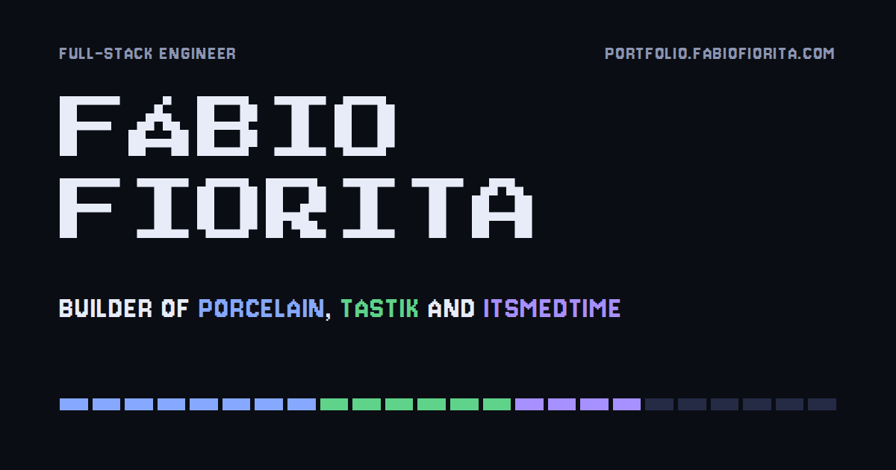

# portfolio.fabiofiorita.com

[My portfolio](https://portfolio.fabiofiorita.com), as a small pixel game: the three products I build (Porcelain, Tastik and ItsMedTime) play out as looping scenes, a player card holds the inventory, and there is a terminal at the bottom that answers back.



## I know why you're here

You opened the source to find the secrets. Respect.

Yes, they are in here. No, this README will not tell you where. Reading the code to find them is the cheat-code route, and the confetti does not judge you for it. It just falls.

There are five. The terminal knows about two of them.

## Run it

You need Node 24 and pnpm.

```sh
pnpm install
pnpm dev        # http://localhost:4321
pnpm build      # static site in dist/
pnpm preview    # serve the build locally
```

That's it. No environment variables, no database, no backend. It builds to plain files.

## How it's built

- [Astro](https://astro.build) renders one static page. No UI framework ships to the browser.
- [Tailwind CSS](https://tailwindcss.com) 4 for styling, with every colour as a token in `src/styles/global.css`.
- [Motion](https://motion.dev) for the animations. Scenes only play while they are on screen, and pixel things move in steps, the way an old screen redraws.
- Press Start 2P, Jersey 10 and JetBrains Mono, all self-hosted through Fontsource.

```
src/
  content.ts            every word and figure on the page, in one place
  pages/index.astro     the page
  pages/llms.txt.ts     the same content as plain text, for language models
  layouts/site.astro    head, header, footer
  components/
    pixel.astro         draws pixel art from rows of characters
    sprites.ts          the reviewer, the pill, the bell, the check mark
    scenes/             the Porcelain, Tastik and ItsMedTime scenes
  scripts/
    scenes.ts           what the scenes do
    terminal.ts         the terminal
    secrets.ts          👀
    confetti.ts         the reward
```

## One source of truth

The page, the terminal and [`/llms.txt`](https://portfolio.fabiofiorita.com/llms.txt) all read from `src/content.ts`, so they can't disagree. Every number in there comes with where it came from and when.

## Accessibility

With reduced motion turned on, nothing animates and nothing is hidden waiting for an animation. If the scripts never load, the page shows itself anyway after a moment.

## Elsewhere

[LinkedIn](https://www.linkedin.com/in/fabiofioritapontes/) · [X](https://x.com/flfiorita) · [GitHub](https://github.com/FabioFiorita) · [Medium](https://medium.com/@fabiolfp)

## License

[MIT](LICENSE). Take the pixel scenes, the terminal or the confetti for your own site. The secrets you have to find yourself.
